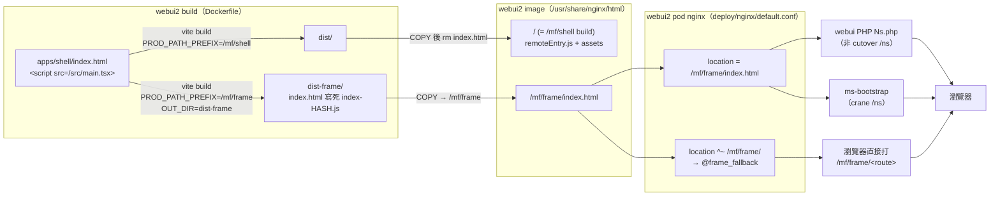
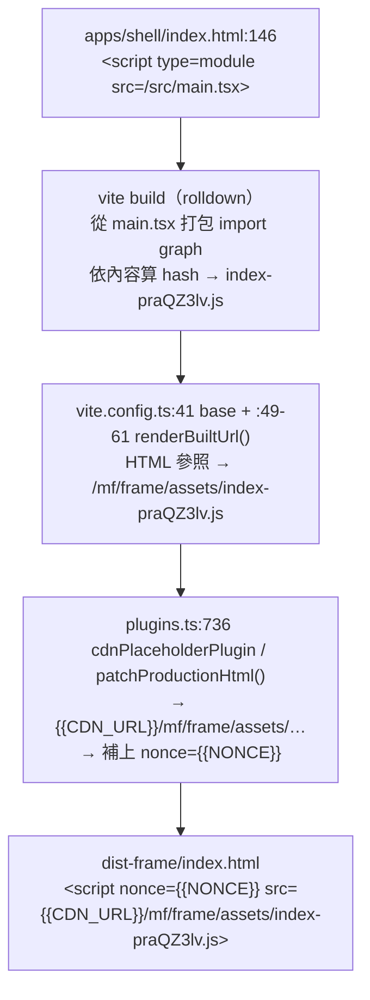
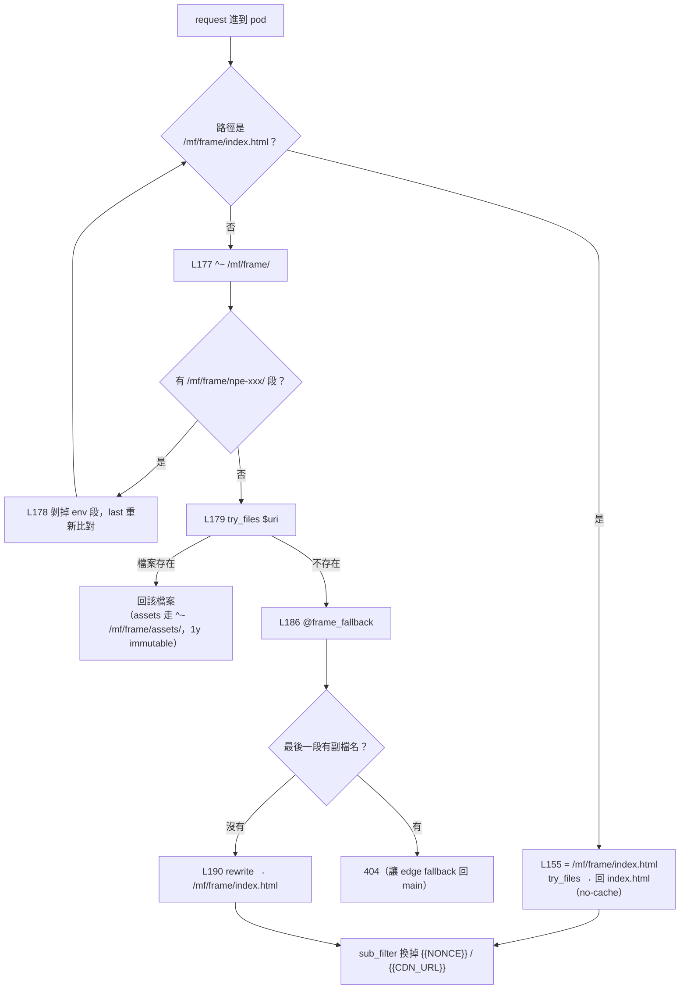
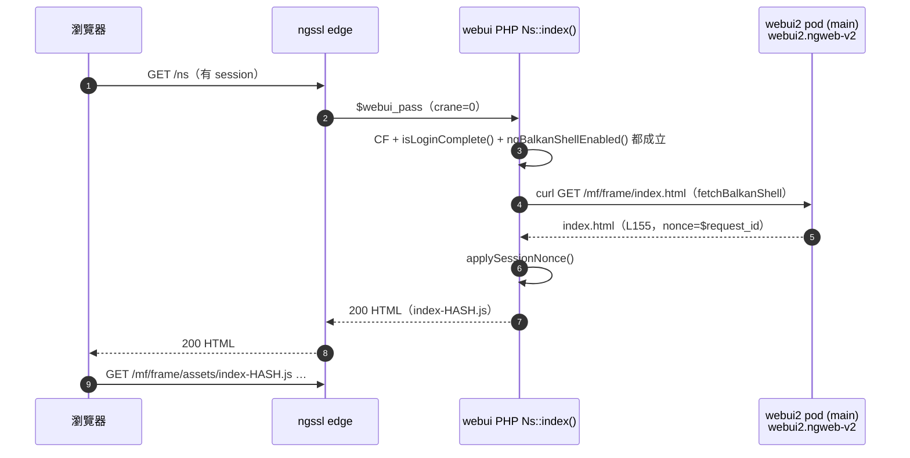
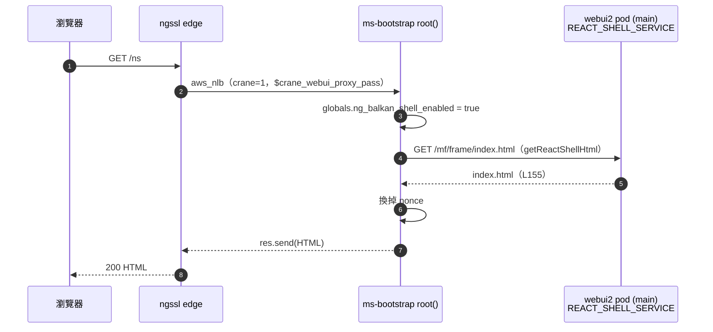
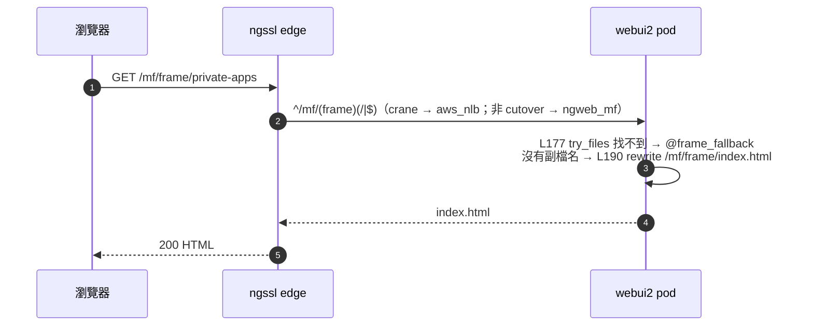
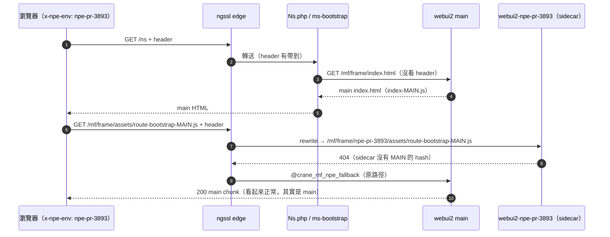
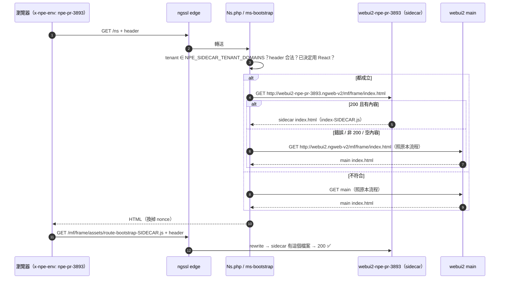

# `dist-frame/index.html` 是怎麼被回傳的

最後更新：2026-11-14。相關文件：[crane-webui2-render.md](crane-webui2-render.md)

這份文件說明全頁 React shell 的入口 HTML（`dist-frame/index.html`），從 build、放進 image、由 pod nginx 送出，一路到被 PHP / ms-bootstrap 代理、最後回給瀏覽器的完整路徑，以及 PR sidecar（`x-npe-env`）修正改了哪一段。

---

## 1. 總覽



---

## 2. Build：檔案從哪裡來

`webui2/Dockerfile`：

```dockerfile
# 同一份原始碼 build 兩次
RUN PUBLIC_PATH_PREFIX=/mf/shell pnpm --filter shell build:cdn                       # → dist/
RUN PUBLIC_PATH_PREFIX=/mf/frame PROD_PATH_PREFIX=/mf/frame OUT_DIR=dist-frame \
    pnpm --filter shell build:cdn                                                    # → dist-frame/

COPY --from=build-deps /usr/src/app/apps/shell/dist /usr/share/nginx/html
69: RUN rm /usr/share/nginx/html/index.html && rm -f /usr/share/nginx/html/50x.html   # 刪掉 dist/index.html（ENG-1000627）
72: COPY --chown=nginx:nginx --from=build-deps /usr/src/app/apps/shell/dist-frame /usr/share/nginx/html/mf/frame
```

- `dist-frame/index.html` 在 pod 裡的位置是 `/usr/share/nginx/html/mf/frame/index.html`，剛好對應 URL `/mf/frame/index.html`。
- `dist/index.html` 被刪掉了，所以 `/mf/shell` 不會回傳 HTML，只提供 `remoteEntry.js` 和 assets，給 Angular 嵌入用。

### index.html 裡的 hash 是怎麼寫進去的



hash 在 build 時就寫死了，main 和每個 PR sidecar 各自 build，hash 都不一樣。

---

## 3. Pod nginx：誰把檔案送出去

`webui2/deploy/nginx/default.conf`：

```nginx
33: sub_filter '{{CDN_URL}}' '';            # 同源，換成空字串
34: sub_filter '{{NONCE}}'   '$request_id';
35: sub_filter_once off;

155: location = /mf/frame/index.html {      # 指名要 index.html（PHP / ms-bootstrap 走這裡）
         add_header Cache-Control "no-cache, no-store, must-revalidate";
         try_files $uri =404;
     }

177: location ^~ /mf/frame/ {               # 其他 /mf/frame/* 路徑
178:     rewrite ^/mf/frame/(npe-[a-zA-Z0-9_-]+)(/.*)$ /mf/frame$2 last;   # 剝掉 sidecar 的 env 段
179:     try_files $uri $uri/ @frame_fallback;
     }

186: location @frame_fallback {             # 檔案不存在時
         if ($uri ~ "\.[^/]+$") { return 404; }   # 有副檔名 → 真正的 404（讓 edge fallback）
190:     rewrite ^ /mf/frame/index.html break;     # SPA route → 回 index.html
     }
```



---

## 4. 三條取得路徑

| 呼叫的人 | 什麼時候 | 抓的 URL | 命中 pod 的哪裡 | 怎麼回給瀏覽器 |
|---|---|---|---|---|
| **webui PHP**（非 cutover） | `/ns`，且 `NG_BALKAN_SHELL_ENABLED`、`isLoginComplete()`、`ngBalkanShellEnabled()` 都成立 | `REACT_SHELL_SERVICE . '/' . REACT_SHELL_INDEX_PATH` = `http://webui2.ngweb-v2/mf/frame/index.html` | L155 | `Ns::getBalkanShellHtml()` → `applySessionNonce()` → `Ns::index()` 的 `$this->output->set_output()` |
| **ms-bootstrap**（crane） | `/ns`，`ng_balkan_shell_enabled` 開 | `${REACT_SHELL_SERVICE}/${REACT_SHELL_INDEX_PATH}` | L155 | `getReactShellHtml()` 換掉 nonce → `root()` 的 `res.send()` |
| **瀏覽器直接打** | `/mf/frame/private-apps` 這類路徑 | edge `^/mf/(frame)(/\|$)` 轉送 | L177 → `@frame_fallback` → L190 | pod nginx 直接回（經過 edge） |

`REACT_SHELL_INDEX_PATH = 'mf/frame/index.html'` 在兩個 repo 都有定義：webui 在 `constants.php:1029`，ms-bootstrap 在 `general.constants.ts:26`。

### 4.1 非 cutover：webui PHP



### 4.2 crane：ms-bootstrap



### 4.3 瀏覽器直接打 `/mf/frame/<route>`



---

## 5. 帶 `x-npe-env` 時：修正前後

### 修正前：server 端固定抓 main



### 修正後（webui#19476、ms-bootstrap#433）：server 端先抓 sidecar



修正只改了第 4 節表格前兩列「抓的 URL」：從 `webui2.ngweb-v2` 換成 `webui2-<env>.ngweb-v2`。build（第 2 節）和 pod nginx（第 3 節）都沒有動。

---

## 6. 程式碼位置

| 位置 | 作用 |
|---|---|
| `webui2/Dockerfile:51,69,72` | build `dist-frame`；刪掉 `dist/index.html`；把 `dist-frame` COPY 到 `/mf/frame` |
| `webui2/apps/shell/index.html:146` | 原始入口 `<script src="/src/main.tsx">` |
| `webui2/apps/shell/vite.config.ts:41,49-61` | `base`、`renderBuiltUrl()` |
| `webui2/apps/shell/vite/env.ts:9-14,60` | `PROD_PATH_PREFIX` 只允許 `/mf/shell`、`/mf/frame` |
| `webui2/apps/shell/vite/plugins.ts:736-770` | `cdnPlaceholderPlugin` / `patchProductionHtml()` |
| `webui2/deploy/nginx/default.conf:33-35,155,177-190` | `sub_filter`；`= /mf/frame/index.html`；`^~ /mf/frame/`；`@frame_fallback` |
| `webui/.../controllers/Ns.php` `index()`、`getBalkanShellHtml()`、`fetchBalkanShell()` | 非 cutover 的 server 端代理 |
| `webui/.../config/constants.php:1028-1029` | `REACT_SHELL_SERVICE`、`REACT_SHELL_INDEX_PATH` |
| `ms-bootstrap/src/app.controller.ts` `root()`、`getReactShellHtml()` | crane 的 server 端代理 |
| `ms-bootstrap/src/constants/general.constants.ts:26` | `REACT_SHELL_INDEX_PATH` |

行號是依 webui2 `origin/master`、webui `develop`、ms-bootstrap `main` 在 2026-11-13～14 的版本。
