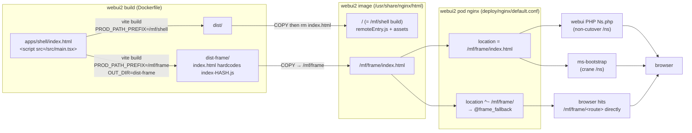
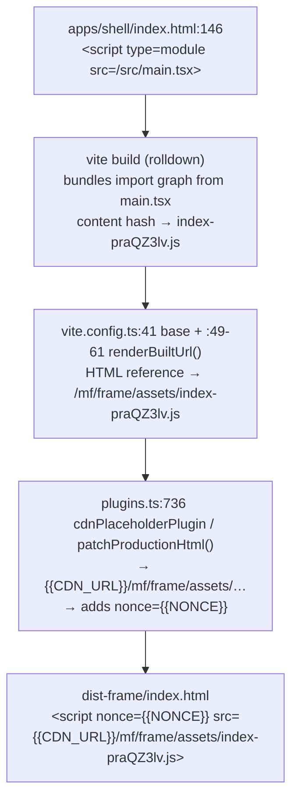
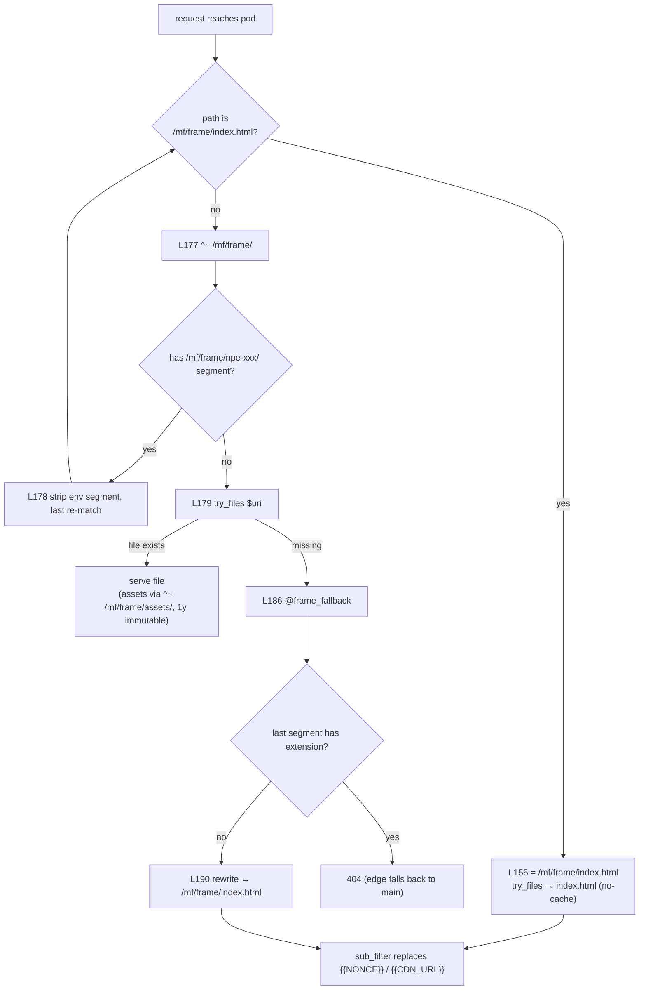
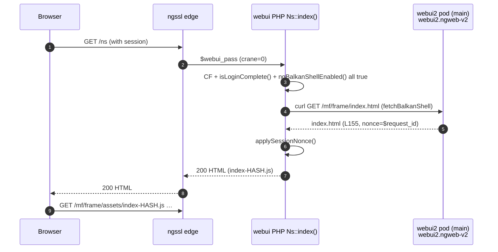
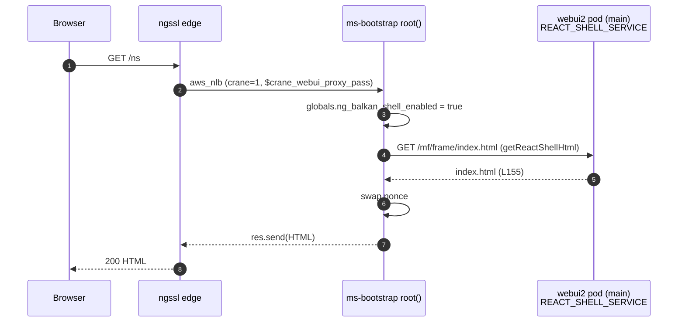
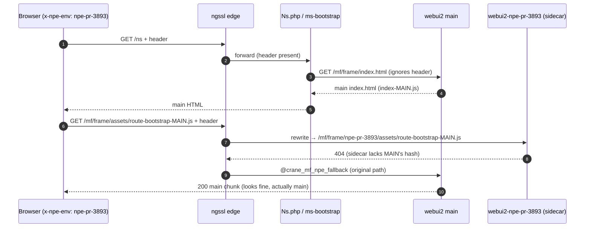
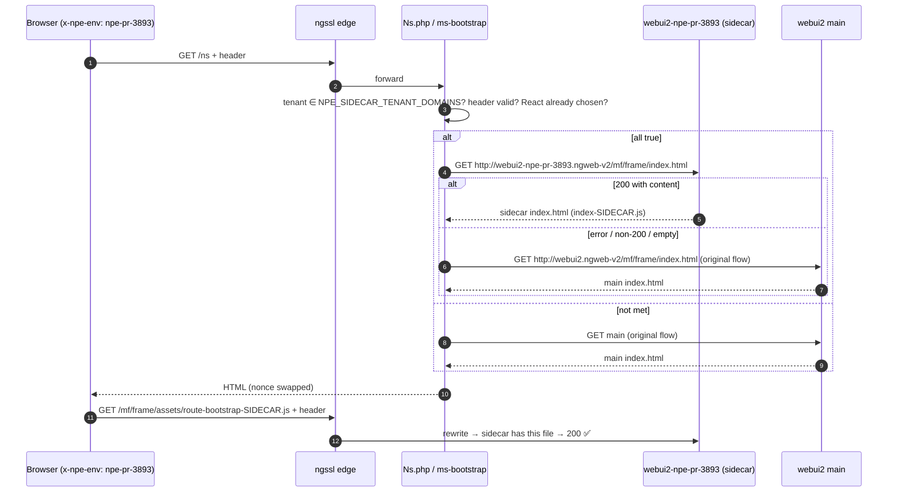

# How `dist-frame/index.html` Gets Served

Last updated: 2026-11-14. Related: [crane-webui2-render.md](crane-webui2-render.md)

The full path of the full-page React shell's entry HTML (`dist-frame/index.html`): build, packaging into the image, served by pod nginx, proxied by PHP / ms-bootstrap, and finally returned to the browser — plus which segment the PR sidecar (`x-npe-env`) fix changed.

---

## 1. Overview



---

## 2. Build: where the files come from

`webui2/Dockerfile`:

```dockerfile
# same source built twice
RUN PUBLIC_PATH_PREFIX=/mf/shell pnpm --filter shell build:cdn                       # → dist/
RUN PUBLIC_PATH_PREFIX=/mf/frame PROD_PATH_PREFIX=/mf/frame OUT_DIR=dist-frame \
    pnpm --filter shell build:cdn                                                    # → dist-frame/

COPY --from=build-deps /usr/src/app/apps/shell/dist /usr/share/nginx/html
69: RUN rm /usr/share/nginx/html/index.html && rm -f /usr/share/nginx/html/50x.html   # delete dist/index.html (ENG-1000627)
72: COPY --chown=nginx:nginx --from=build-deps /usr/src/app/apps/shell/dist-frame /usr/share/nginx/html/mf/frame
```

- In the pod, `dist-frame/index.html` lives at `/usr/share/nginx/html/mf/frame/index.html`, matching URL `/mf/frame/index.html`.
- `dist/index.html` is deleted, so `/mf/shell` never returns HTML — only `remoteEntry.js` and assets, for Angular embedding.

### How the hash gets into index.html



The hash is baked in at build time; main and each PR sidecar build separately with different hashes.

---

## 3. Pod nginx: who serves the file

`webui2/deploy/nginx/default.conf`:

```nginx
33: sub_filter '{{CDN_URL}}' '';            # same origin → empty string
34: sub_filter '{{NONCE}}'   '$request_id';
35: sub_filter_once off;

155: location = /mf/frame/index.html {      # explicit index.html (PHP / ms-bootstrap hit this)
         add_header Cache-Control "no-cache, no-store, must-revalidate";
         try_files $uri =404;
     }

177: location ^~ /mf/frame/ {               # all other /mf/frame/* paths
178:     rewrite ^/mf/frame/(npe-[a-zA-Z0-9_-]+)(/.*)$ /mf/frame$2 last;   # strip sidecar env segment
179:     try_files $uri $uri/ @frame_fallback;
     }

186: location @frame_fallback {             # file not found
         if ($uri ~ "\.[^/]+$") { return 404; }   # has extension → real 404 (lets edge fall back)
190:     rewrite ^ /mf/frame/index.html break;     # SPA route → index.html
     }
```



---

## 4. Three fetch paths

| Caller | When | URL fetched | Pod location hit | How it reaches the browser |
|---|---|---|---|---|
| **webui PHP** (non-cutover) | `/ns`, with `NG_BALKAN_SHELL_ENABLED`, `isLoginComplete()`, `ngBalkanShellEnabled()` all true | `REACT_SHELL_SERVICE . '/' . REACT_SHELL_INDEX_PATH` = `http://webui2.ngweb-v2/mf/frame/index.html` | L155 | `Ns::getBalkanShellHtml()` → `applySessionNonce()` → `$this->output->set_output()` in `Ns::index()` |
| **ms-bootstrap** (crane) | `/ns`, `ng_balkan_shell_enabled` on | `${REACT_SHELL_SERVICE}/${REACT_SHELL_INDEX_PATH}` | L155 | `getReactShellHtml()` swaps nonce → `res.send()` in `root()` |
| **Browser directly** | paths like `/mf/frame/private-apps` | edge `^/mf/(frame)(/\|$)` forwards | L177 → `@frame_fallback` → L190 | pod nginx responds directly (through the edge) |

`REACT_SHELL_INDEX_PATH = 'mf/frame/index.html'` is defined in both repos: webui `constants.php:1029`, ms-bootstrap `general.constants.ts:26`.

### 4.1 Non-cutover: webui PHP



### 4.2 crane: ms-bootstrap



### 4.3 Browser hits `/mf/frame/<route>` directly

```mermaid
sequenceDiagram
  autonumber
  participant B as Browser
  participant E as ngssl edge
  participant W as webui2 pod
  B->>E: GET /mf/frame/private-apps
  E->>W: ^/mf/(frame)(/|$) (crane → aws_nlb; non-cutover → ngweb_mf)
  W->>W: L177 try_files miss → @frame_fallback<br/>no extension → L190 rewrite /mf/frame/index.html
  W-->>E: index.html
  E-->>B: 200 HTML
```

---

## 5. With `x-npe-env`: before and after the fix

### Before: the server always fetches main



### After (webui#19476, ms-bootstrap#433): the server tries the sidecar first



The fix only changed the "URL fetched" column in the first two rows of §4: from `webui2.ngweb-v2` to `webui2-<env>.ngweb-v2`. Build (§2) and pod nginx (§3) were untouched. (The final ✅ step holds on the crane/AWS path; the non-crane MP path also needs webui2#4282 — see [sidecar-webui2.md](sidecar-webui2.md) §2.)

---

## 6. Code locations

| Location | Role |
|---|---|
| `webui2/Dockerfile:51,69,72` | build `dist-frame`; delete `dist/index.html`; COPY `dist-frame` to `/mf/frame` |
| `webui2/apps/shell/index.html:146` | source entry `<script src="/src/main.tsx">` |
| `webui2/apps/shell/vite.config.ts:41,49-61` | `base`, `renderBuiltUrl()` |
| `webui2/apps/shell/vite/env.ts:9-14,60` | `PROD_PATH_PREFIX` only allows `/mf/shell`, `/mf/frame` |
| `webui2/apps/shell/vite/plugins.ts:736-770` | `cdnPlaceholderPlugin` / `patchProductionHtml()` |
| `webui2/deploy/nginx/default.conf:33-35,155,177-190` | `sub_filter`; `= /mf/frame/index.html`; `^~ /mf/frame/`; `@frame_fallback` |
| `webui/.../controllers/Ns.php` `index()`, `getBalkanShellHtml()`, `fetchBalkanShell()` | non-cutover server-side proxy |
| `webui/.../config/constants.php:1028-1029` | `REACT_SHELL_SERVICE`, `REACT_SHELL_INDEX_PATH` |
| `ms-bootstrap/src/app.controller.ts` `root()`, `getReactShellHtml()` | crane server-side proxy |
| `ms-bootstrap/src/constants/general.constants.ts:26` | `REACT_SHELL_INDEX_PATH` |

Line numbers are from webui2 `origin/master`, webui `develop`, ms-bootstrap `main` as of 2026-11-13–14.
